# MediFlow AI - PostgreSQL Database Schema Design

**Status:** Proposal-aligned academic MVP design. This document describes a proposed
schema; it is not a migration, an implementation claim, or PostgreSQL verification.

**Functional authority:** `MediFlow_AI_Final_Checked.docx` is the primary proposal.
The design preserves synthetic academic data, source-linked clinical memory, consent,
clinician approval, restricted notes, prescription review, pharmacy minimum-necessary
access, and append-only correction history.

**Approved technology boundary:** PostgreSQL is the approved structured database;
Python/FastAPI is the approved backend direction. React/Vite/TypeScript/Tailwind is
the approved frontend direction. No provider, hosting platform, OCR/ASR/LLM service,
object store, queue, Redis deployment, FHIR server, or ABDM integration is selected
by this document.

## 1. Design principles

1. Every hospital-owned row carries `hospital_id UUID NOT NULL`.
2. Every relationship between hospital-owned rows is tenant-qualified:
   `(hospital_id, child_id) REFERENCES parent(hospital_id, id)`.
3. Every hospital-owned table has `PRIMARY KEY (id)` and
   `UNIQUE (hospital_id, id)` so it can be a referenced composite key.
4. A foreign key prevents a missing or cross-tenant parent; it does not replace
   backend authorization, patient-purpose checks, or row-level security.
5. A row containing both `patient_id` and `encounter_id` must enforce that the
   encounter belongs to that patient. Direct FKs establish existence and tenant;
   a composite patient/encounter key or the documented transaction constraint
   establishes same-patient integrity.
6. AI output is always a draft until an authorized clinician reviews and approves
   it. AI cannot diagnose, prescribe, sign, or approve a clinical decision.
7. Approved history is never silently overwritten. Corrections append a version,
   reason, actor, timestamp, and audit event.
8. Original documents, audio, transcript versions, source locations, uncertainty,
   negation, author, date, and verification state are retained where applicable.
9. The academic MVP uses synthetic patient data only and makes no production,
   regulatory, interoperability, or clinical-safety certification claim.

## 2. Scope and tenancy

### 2.1 Ownership classes

**Global/shared:** `users`, `medicine_catalogue_items`, and (if later approved)
`roles`, `permissions`, and `role_permissions`.

**Hospital-owned:** all other tables in this document, including the hospital
root, assignments, patients, encounters, clinical records, processing, pharmacy,
and audit records. Shared catalogue rows contain no patient data and do not cross
hospital clinical records by themselves.

No cross-hospital patient sharing or merge is proposed. External exchange,
provider-to-provider relationships, and ABDM/FHIR exchange are future extensions.

### 2.2 Tenant-qualified key convention

Each hospital-owned table has:

```text
PRIMARY KEY (id)
UNIQUE (hospital_id, id)
FOREIGN KEY (hospital_id) REFERENCES hospitals(id) ON DELETE RESTRICT
```

The canonical relationship is:

```text
FOREIGN KEY (hospital_id, patient_id)
  REFERENCES patients(hospital_id, id) ON DELETE RESTRICT
```

The same form is used for encounters, documents, assignments, prescriptions,
notes, jobs, and all other tenant-owned parents. Child deletion is `RESTRICT`
for clinical history unless a table definition explicitly says otherwise.
Updates to identifiers are `RESTRICT`; corrections create new rows or versions.

### 2.3 Patient/encounter invariant

`encounters` has `UNIQUE (hospital_id, id, patient_id)`. A child that stores both
IDs uses:

```text
FOREIGN KEY (hospital_id, encounter_id, patient_id)
  REFERENCES encounters(hospital_id, id, patient_id)
```

This is the preferred database-enforced form. Where a child cannot use the
three-column key because it has a nullable encounter or a parent relationship
that is itself conditional, it has both tenant-qualified FKs and an **explicit
application transaction constraint**: lock/read the encounter and patient in the
same transaction, compare both hospital and patient IDs, and reject the write.
The same-patient rule applies to documents, notes, prescriptions, care plans,
briefings, AI outputs, consent, audio, processing, and audit rows.

### 2.4 Hospital-user relationship

`users.id` is global identity. `hospital_users.id` is the hospital assignment
identity and is the only identity used by hospital-owned author, doctor,
pharmacist, reviewer, and actor columns:

```text
FOREIGN KEY (hospital_id, hospital_user_id)
  REFERENCES hospital_users(hospital_id, id)
```

This prevents a valid global user from being treated as an assignment in a
hospital where no assignment exists. The current implementation uses
`role_code`, not `role_id`; see Section 4.1.

## 3. Entity scope and implementation order

### 3.1 Required academic MVP entities

`hospitals`, `users`, `hospital_users`, `patients`, `patient_identifiers`,
`patient_match_candidates`, `appointments`, `encounters`,
`provenance_records`, `conditions`, `allergy_intolerances`,
`observations`, `medication_statements`, `medical_documents`, `document_pages`,
`document_regions`, `document_extractions`, `document_extraction_corrections`,
`consent_records`, `audio_assets`, `transcript_versions`, `transcript_segments`,
`transcript_corrections`, `ai_output_runs`, `ai_extracted_facts`,
`clinical_draft_versions`, `clinical_notes`, `clinical_note_versions`,
`restricted_doctor_notes`, `restricted_doctor_note_versions`,
`medicine_catalogue_items`, `prescription_drafts`, `prescription_draft_lines`,
`signed_prescriptions`, `prescription_lines`, `dispensing_records`,
`dispensing_lines`, `care_plans`, `care_instructions`, `care_instruction_changes`,
`follow_ups`, `processing_jobs`, `processing_attempts`, `audit_events`, and
`clinical_record_versions`.

Queue sessions and queue entries are **conditional MVP extensions, not required
for the initial MVP implementation**. They are blocked because the proposal
does not approve a token-reset boundary. If a session/date/shift boundary is
approved, `queue_entries.queue_session_id` becomes `NOT NULL` and token
uniqueness is `(hospital_id, queue_session_id, token_number)`.

### 3.2 Optional academic extensions

`clinical_facts` is optional when typed facts cover the demonstration.
`briefing_preparation` is optional persistence for generated briefing status.
`roles`, `permissions`, and `role_permissions` are optional normalization.
FHIR-shaped export, trend views, and additional source payloads are optional
only after their data-minimization and validation boundaries are approved.

### 3.3 Future production or integration extensions

External identifiers and exchange consent, ABDM/FHIR integration, production
identity federation, digital signatures, licensed terminology and medicine
interaction data, billing/insurance, patient messaging, adherence, retention/legal
hold, production object storage, production job infrastructure, and provider
organizations are future scope. They are not required to implement this design.

### 3.4 Recommended dependency order

1. `hospitals`, `users`, `hospital_users` (with validated `role_code`).
2. `patients`, identifiers, match review and merge audit.
3. appointments and encounters; activate conditional queue sessions and entries
   only after the session/date/shift boundary is approved.
4. provenance and typed longitudinal facts.
5. documents, pages, regions, extraction and correction history.
6. consent, audio, transcript and correction history.
7. AI runs, extracted draft facts, clinical drafts and approved notes.
8. medicine catalogue, prescription drafts, signed prescriptions and lines.
9. pharmacy dispensing and restricted access audit.
10. care plans, instructions, follow-ups, jobs, versions and complete audit.

## 4. Proposed table definitions

All UUIDs below are PostgreSQL `UUID`; timestamps are `TIMESTAMPTZ`. Unless
otherwise stated, `id` is the primary key, `(hospital_id, id)` is unique, the
hospital FK is `ON DELETE RESTRICT ON UPDATE RESTRICT`, and timestamps are
non-null. `CHECK` values are illustrative controlled values for the MVP.

### 4.1 Identity and tenant tables

#### `hospitals` - Required MVP

Columns: `id UUID`; `name VARCHAR(255) NOT NULL`; `code VARCHAR(64) NOT NULL`;
`status VARCHAR(24) NOT NULL CHECK (status IN ('active','suspended','inactive'))`;
`created_at`; `updated_at`.

Constraints: `UNIQUE(code)`. Root table; no hospital FK.

#### `users` - Required MVP

Columns: `id UUID`; `email VARCHAR(320) NULL`; `display_name VARCHAR(255) NOT NULL`;
`status VARCHAR(24) NOT NULL CHECK (status IN ('active','disabled'))`;
`identity_subject VARCHAR(255) NULL`; `created_at`; `updated_at`.

Constraints: unique non-null `email` and unique non-null `identity_subject`.
This table stores identity only and has no hospital role.

#### `hospital_users` - Required MVP

Columns: `id UUID`; `hospital_id UUID NOT NULL`; `user_id UUID NOT NULL`;
`role_code VARCHAR(64) NOT NULL`; `relationship_scope VARCHAR(24) NOT NULL
CHECK (relationship_scope IN ('hospital','department','patient_relationship'))`;
`status VARCHAR(24) NOT NULL CHECK (status IN ('active','suspended','expired'))`;
`valid_from TIMESTAMPTZ NOT NULL`; `valid_until TIMESTAMPTZ NULL`;
`created_at`; `updated_at`.

FKs: `hospital_id -> hospitals.id`; `user_id -> users.id`, both `RESTRICT`.
Unique: `(hospital_id, id)` and `(hospital_id, user_id, role_code, valid_from)`.
Expired assignments remain for history.

**Role decision:** retain `role_code` for the academic MVP and validate an
approved allow-list (`doctor`, `pharmacist`, `staff`, and other user-approved
roles) in both application logic and a database check when finalized. Do not
add role tables now: the current implementation uses `role_code`, and adding
normalized roles would expand this task. A future role/permission design must
document its rationale before adoption. This is a proposed schema decision,
not a claim that the current model has a role allow-list.

#### Optional `roles`, `permissions`, `role_permissions`

If normalized authorization is approved later: `roles(id, code UNIQUE, name,
is_system)`; `permissions(id, code UNIQUE, description)`; and
`role_permissions(role_id, permission_id)` with a composite primary key and
RESTRICT FKs to the two global tables. They are not referenced by the current
`hospital_users` design.

### 4.2 Patient identity

#### `patients` - Required MVP

Columns: `id UUID`; `hospital_id UUID NOT NULL`; `synthetic_mrn VARCHAR(64) NOT NULL`;
`given_name VARCHAR(128) NOT NULL`; `family_name VARCHAR(128) NOT NULL`;
`date_of_birth DATE NOT NULL`; `sex_at_birth VARCHAR(24) NULL`;
`identity_status VARCHAR(24) NOT NULL CHECK (identity_status IN
('verified','probable','unverified','merged'))`; `merged_into_patient_id UUID NULL`;
`created_at`; `updated_at`.

FKs: `hospital_id -> hospitals.id`. The merge relationship is the composite
FK `(hospital_id, merged_into_patient_id) -> patients(hospital_id, id)` with
`ON DELETE RESTRICT ON UPDATE RESTRICT`. Unique `(hospital_id, id)` and
`(hospital_id, synthetic_mrn)`. A merge is same-hospital only; delete of a
referenced target is rejected, preserving history. The current implementation
uses this composite FK and explicit `merged_into` relationship.

#### `patient_identifiers` - Required MVP

Columns: `id`; `hospital_id UUID NOT NULL`; `patient_id UUID NOT NULL`;
`identifier_type VARCHAR(64) NOT NULL`; `identifier_value VARCHAR(255) NOT NULL`;
`verification_status VARCHAR(24) NOT NULL CHECK (verification_status IN
('verified','unverified','historical'))`; `created_at`.

Composite FK `(hospital_id, patient_id) -> patients(hospital_id, id)`.
Unique `(hospital_id, identifier_type, identifier_value)`.

#### `patient_match_candidates` - Required MVP

Columns: `id`; `hospital_id UUID NOT NULL`; `candidate_patient_id UUID NOT NULL`;
`possible_patient_id UUID NOT NULL`; `match_score NUMERIC(5,4) NULL`;
`status VARCHAR(24) NOT NULL CHECK (status IN
('open','confirmed_same','confirmed_different','closed'))`;
`reviewed_by_hospital_user_id UUID NULL`; `reviewed_at TIMESTAMPTZ NULL`; `created_at`.

Composite FKs for both patient IDs to `patients(hospital_id,id)` and
`(hospital_id, reviewed_by_hospital_user_id) -> hospital_users(hospital_id,id)`.
`candidate_patient_id <> possible_patient_id` is a check. Confirmation and
merge are a clinician-approved transaction plus audit event; no autonomous
identity merge is permitted.

### 4.3 Scheduling and queue

#### `appointments` - Required MVP

Columns: `id`; `hospital_id`; `patient_id UUID NOT NULL`; `doctor_hospital_user_id UUID NOT NULL`;
`scheduled_at TIMESTAMPTZ NOT NULL`; `status VARCHAR(24) NOT NULL CHECK (status IN
('scheduled','checked_in','cancelled','completed','no_show'))`; `created_at`.

FKs: `(hospital_id, patient_id) -> patients`; `(hospital_id, doctor_hospital_user_id) ->
hospital_users`. Unique/indexes may include `(hospital_id, doctor_hospital_user_id,
scheduled_at)`; no cross-hospital appointment is valid.

#### `encounters` - Required MVP

Columns: `id`; `hospital_id`; `patient_id UUID NOT NULL`; `appointment_id UUID NULL`;
`doctor_hospital_user_id UUID NOT NULL`; `started_at TIMESTAMPTZ NULL`; `ended_at TIMESTAMPTZ NULL`;
`status VARCHAR(24) NOT NULL CHECK (status IN
('planned','in_progress','completed','cancelled'))`; `created_at`.

FKs: `(hospital_id, patient_id) -> patients`; `(hospital_id, appointment_id) ->
appointments` when non-null; `(hospital_id, doctor_hospital_user_id) -> hospital_users`.
Unique `(hospital_id, id, patient_id)` is the parent key for same-patient child
FKs. Application transaction constraint: an appointment's patient must equal the
encounter patient. Check `ended_at IS NULL OR started_at IS NULL OR ended_at >= started_at`.

#### `queue_sessions` - Optional/conditional MVP, currently blocked

Columns: `id`; `hospital_id`; `doctor_hospital_user_id UUID NOT NULL`; `session_date DATE NOT NULL`;
`starts_at TIMESTAMPTZ NOT NULL`; `ends_at TIMESTAMPTZ NULL`;
`status VARCHAR(24) NOT NULL CHECK (status IN ('open','closed','cancelled'))`.

FKs: `(hospital_id, doctor_hospital_user_id) -> hospital_users`. Check end after start.
If approved, unique `(hospital_id, doctor_hospital_user_id, session_date, starts_at)` and
`(hospital_id,id)` are keys. The exact boundary and token reset remain unresolved.

#### `queue_entries` - Conditional MVP, currently blocked

Columns: `id`; `hospital_id`; `appointment_id UUID NOT NULL`; `queue_session_id UUID NULL`;
`doctor_hospital_user_id UUID NOT NULL`; `token_number VARCHAR(32) NOT NULL`;
`status VARCHAR(24) NOT NULL CHECK (status IN
('waiting','called','in_consultation','completed','cancelled'))`;
`checked_in_at TIMESTAMPTZ NOT NULL`; `called_at TIMESTAMPTZ NULL`; `created_at`.

FKs: `(hospital_id, appointment_id) -> appointments`; `(hospital_id,
doctor_hospital_user_id) -> hospital_users`; conditional `(hospital_id, queue_session_id)
-> queue_sessions`. Application transaction checks appointment and session
doctor/tenant match. Do not add token uniqueness until the boundary is approved;
then make `queue_session_id NOT NULL` and unique `(hospital_id, queue_session_id,
token_number)`.

#### Optional `briefing_preparation`

If persisted, columns are `id`, `hospital_id`, `patient_id`, nullable
`encounter_id`, `requested_by_hospital_user_id`, `status`, `started_at`, nullable
`completed_at`, and non-sensitive `error_safe_summary`. FKs are tenant-qualified
patient, optional encounter, and hospital-user requester. When encounter is
present, use the same-patient composite key or transaction constraint.

### 4.4 Provenance and longitudinal facts

#### `provenance_records` - Required MVP

Columns: `id`; `hospital_id`; nullable `patient_id`; nullable `encounter_id`;
`source_type VARCHAR(32) NOT NULL CHECK (source_type IN
('conversation','document','doctor_entry','patient_statement','import',
'ai_draft','prescription','catalogue'))`; nullable `source_record_id`;
nullable `author_hospital_user_id`; `recorded_at`; nullable `source_at`;
`verification_status VARCHAR(24) NOT NULL CHECK (verification_status IN
('unverified','reviewed','verified','disputed'))`; `uncertainty VARCHAR(24) NOT NULL`;
nullable `confidence NUMERIC(5,4)`; nullable `notes`.

The uncertainty vocabulary is intentionally unresolved in the approved schema.
The implementation requires a non-null value but does not enforce an enum or
check constraint until the allowed vocabulary is approved.

FKs: optional `(hospital_id, patient_id) -> patients`; optional
`(hospital_id, encounter_id) -> encounters`; optional
`(hospital_id, author_hospital_user_id) -> hospital_users`. If both patient and encounter
are present, the three-column encounter key or transaction constraint applies.
`source_record_id` is an intentional polymorphic reference; `source_type` must
be allow-listed and validated in the same transaction against tenant and patient.

#### Typed facts - Required MVP

`conditions`, `allergy_intolerances`, `observations`, and `medication_statements`
each have `id`, `hospital_id`, `patient_id`, nullable `encounter_id`,
`provenance_id`, typed clinical fields, verification/status fields, and
`recorded_at`. Each has composite FKs to patient, optional encounter, and
`provenance_records(hospital_id,id)` plus the patient-qualified provenance key
where supported. The three-column encounter FK or same-patient transaction rule
is mandatory, and provenance must belong to the same patient.

Additional columns:

- `conditions`: nullable `code_system`, `code_value`, required `display_name`,
  status, verification status, nullable `onset_at`, nullable
  `superseded_by_condition_id` composite self-FK.
- `allergy_intolerances`: required `substance`, nullable `reaction`,
  nullable `criticality` (`low`, `high`, `unknown`, `unable_to_assess`),
  status, verification status, nullable `reported_at`.
- `observations`: required `observation_type`, optional `test_name`,
  optional `value_text`, optional `value_numeric`, optional `unit`,
  optional `reference_range`, nullable `reported_at`; check at least one value.
- `medication_statements`: required `medicine_name`, nullable
  `catalogue_item_id` (planned FK to `medicine_catalogue_items.id` once that
  table is implemented), `statement_type`,
  status, nullable dose/start/end, and nullable composite self-FK
  `superseded_by_statement_id`; check end is not before start.

#### Optional `clinical_facts`

Columns: `id`, `hospital_id`, `patient_id`, `fact_type`, `fact_status`,
`source_type`, nullable polymorphic `source_id`, nullable author assignment,
verification/uncertainty, optional `content_json`, validity timestamps, and
nullable composite self-FK `superseded_by_fact_id`. It must not replace typed
facts or bypass provenance validation.

### 4.5 Documents and exact source navigation

#### `medical_documents` - Required MVP

Columns: `id`, `hospital_id`, `patient_id`, nullable `encounter_id`,
`document_type`, `original_name`, `mime_type`, `object_uri`, nullable `sha256`,
nullable `document_date`, `upload_date`, nullable `issuing_source`, nullable
positive `page_count`, `processing_status`, `retention_status`, and
`uploaded_by_hospital_user_id NOT NULL`.

FKs: patient, optional same-patient encounter, and uploader assignment. The
object URI is a reference, not a credential. Duplicate detection must not
silently merge or overwrite documents.

#### `document_pages`, `document_regions` - Required MVP

`document_pages`: `id`, `hospital_id`, `document_id`, positive `page_number`,
optional numeric `width`/`height`, `text_source`, `created_at`; composite FK to
`medical_documents`; unique `(hospital_id, document_id, page_number)`.

`document_regions`: `id`, `hospital_id`, `document_page_id`, `region_type`,
nullable coordinates/dimensions, nullable `text`, nullable confidence; composite
FK to pages; non-negative dimensions and confidence 0..1.

#### `document_extractions`, `document_extraction_corrections` - Required MVP

Extraction columns: `id`, `hospital_id`, `document_id`, nullable `document_region_id`,
`field_name`, nullable `extracted_value`, nullable `normalized_value`, nullable
`unit`, nullable `reference_range`, `extraction_status`, nullable confidence,
nullable reviewer assignment and timestamp. Composite FKs to document, optional
region, and reviewer; document/region same-document validation is transactional.

Correction columns: `id`, `hospital_id`, `extraction_id`,
`corrected_by_hospital_user_id`,
nullable `previous_value`, `corrected_value`, `reason`, `corrected_at`.
Composite FKs to extraction and correcting hospital assignment. Append-only.

### 4.6 Consent, audio, and transcript

#### `consent_records` - Required MVP

Columns: `id`, `hospital_id`, `patient_id`, `encounter_id NOT NULL`,
`consent_type`, `decision`, nullable `captured_by_hospital_user_id`, `captured_at`,
`effective_from`, nullable `effective_until`, nullable `evidence_reference`.

Composite FKs to patient, three-column same-patient encounter, and optional
capturing assignment. Multiple rows are intentional: each grant, decline,
withdrawal, expiry, or later decision is an event. There is no one-consent-row
per-encounter constraint. The applicable decision is selected by type and
effective timestamp in a transaction; withdrawal blocks subsequent actions.

#### `audio_assets` - Required MVP

Columns: `id`, `hospital_id`, `patient_id`, `encounter_id`, `consent_record_id`,
`object_uri`, `mime_type`, nullable non-negative `duration_ms`, nullable `sha256`,
`retention_status`, `created_at`.

Composite FKs to patient, same-patient encounter, and consent. Application
transaction constraint: consent belongs to the same patient/encounter, is
`consultation_recording`, and is the effective `granted` decision at capture.

#### `transcript_versions`, `transcript_segments`, `transcript_corrections` - Required MVP

Versions: `id`, `hospital_id`, `audio_asset_id`, positive `version_number`,
`status`, nullable creator assignment, `created_at`; composite FK to audio and
unique `(hospital_id, audio_asset_id, version_number)`.

Segments: `id`, `hospital_id`, `transcript_version_id`, non-negative
`start_ms`, `end_ms >= start_ms`, `speaker_label`, nullable confidence,
`text`, nullable `uncertainty_flags`; composite FK to version.

Corrections: `id`, `hospital_id`, `segment_id`, `corrected_by_hospital_user_id`,
nullable previous text/label, corrected text/label, nullable reason,
`corrected_at`; composite FKs to segment and assignment. Original versions remain.

### 4.7 AI drafts and clinical notes

#### `ai_output_runs`, `ai_extracted_facts` - Required MVP

Run columns: `id`, `hospital_id`, `patient_id`, nullable `encounter_id`,
`output_type`, nullable model/prompt identifiers, `status`, `created_at`,
nullable `completed_at`; patient and same-patient encounter composite FKs.

Fact columns: `id`, `hospital_id`, `ai_output_run_id`, `fact_category`, `text`,
`negated`, `uncertain`, `source_type`, nullable polymorphic `source_record_id`,
nullable offsets, nullable confidence, `status`. Composite FK to run.
Source references are intentional polymorphic references and must be validated
against the run's tenant/patient/encounter; `approved` requires clinician action.

#### `clinical_draft_versions` - Required MVP

Columns: `id`, `hospital_id`, `patient_id`, `encounter_id`, nullable
`ai_output_run_id`, `created_by_hospital_user_id`, positive `version_number`, nullable
draft sections (`chief_complaint`, `history_present_illness`,
`examination_findings`, `assessment`, `plan`), `status`, nullable approval
timestamp and approver. Composite FKs to patient, same-patient encounter,
optional matching AI run, creator, and approver assignment. Unique
`(hospital_id, encounter_id, version_number)`. Approved status requires both
approval fields and an authorized clinician transaction.

#### `clinical_notes`, `clinical_note_versions` - Required MVP

`clinical_notes`: `id`, `hospital_id`, `patient_id`, `encounter_id`, nullable
`draft_version_id`, `author_hospital_user_id`, `status`, nullable approval fields,
`created_at`, nullable `superseded_by_note_id`. Composite FKs to patient,
same-patient encounter, optional matching draft, author, approver, and
self-reference. Approved notes are append/versioned.

`clinical_note_versions`: `id`, `hospital_id`, `clinical_note_id`,
positive `version_number`, `content`, nullable `change_reason`, `author_hospital_user_id`,
`created_at`; composite FKs to note and author; unique
`(hospital_id, clinical_note_id, version_number)`. The identity row does not
silently replace version content.

#### `restricted_doctor_notes`, `restricted_doctor_note_versions` - Required MVP

The active note has `id`, `hospital_id`, `patient_id`, `encounter_id`,
`author_hospital_user_id`, `content`, `permission_scope`, `status`, nullable
`superseded_by_note_id`, `created_at`. The version table has `id`, `hospital_id`,
`restricted_note_id`, positive `version_number`, `content`, `permission_scope`,
nullable `change_reason`, `author_hospital_user_id`, `created_at`.

Composite FKs enforce tenant, patient/encounter, author, note/version, and
self-reference relationships. Unique `(hospital_id, restricted_note_id,
version_number)`. Pharmacy and patient-facing queries must not include these
rows unless a separate approved authorization explicitly permits it.

### 4.8 Medicines, prescriptions, and dispensing

#### `medicine_catalogue_items` - Required MVP

Global columns: `id`, `catalogue_name`, `catalogue_version`, `generic_name`,
nullable `brand_name`, nullable `active_ingredient`, nullable `manufacturer`,
nullable `strength`, nullable `dosage_form`, nullable `route`, nullable
`prescribing_information`, `source_name`, nullable `source_uri`, nullable
`source_updated_at`, `status`. Unique business key must use a reviewed
null-safe PostgreSQL index; catalogue licensing and source remain unresolved.

#### `prescription_drafts`, `prescription_draft_lines` - Required MVP

Draft columns: `id`, `hospital_id`, `patient_id`, `encounter_id`,
`created_by_hospital_user_id`, nullable `ai_output_run_id`, `status`, `created_at`.
Composite FKs to patient, same-patient encounter, creator assignment, and
optional matching AI run. Draft status is never a signed prescription.

Draft-line columns: `id`, `hospital_id`, `draft_id`, nullable catalogue item,
`medicine_name`, nullable strength/dose/route/frequency/duration/quantity,
nullable instructions. Composite FK to draft and ordinary FK to shared catalogue.
Missing dose or instructions remain unknown.

#### `signed_prescriptions`, `prescription_lines` - Required MVP

Signed prescription columns: `id`, `hospital_id`, `patient_id`, `encounter_id`,
`draft_id`, `prescribing_hospital_user_id`, `signed_at`, `status`, nullable
`signature_reference`. Composite FKs to patient, same-patient encounter, draft,
and prescriber assignment. The approval/signing transaction must verify the draft
is approved and the prescriber is authorized; AI cannot perform this action.

Prescription-line columns: `id`, `hospital_id`, `prescription_id`, nullable
catalogue item, `medicine_name`, nullable strength/dose/route/frequency/duration/
quantity, nullable instructions. Composite FK to signed prescription and
ordinary FK to catalogue. Unique `(hospital_id, prescription_id, id)` is
available for line references.

#### `dispensing_records`, `dispensing_lines` - Required MVP

Record columns: `id`, `hospital_id`, `patient_id`, `prescription_id`,
`pharmacist_hospital_user_id`, `status` (`viewed`, `dispensing`, `partially_dispensed`,
`dispensed`, `clarification_requested`, `cancelled`), `substitution_allowed`,
nullable `substitution_text`, nullable `clarification_text`, nullable
`dispensed_at`, `created_at`, `updated_at`.

Line columns: `id`, `hospital_id`, `dispensing_record_id`,
`prescription_line_id`, `quantity_prescribed`, `quantity_dispensed`,
`unit`, `status` (`pending`, `partial`, `dispensed`, `unavailable`), nullable
`clarification_text`, `created_at`, `updated_at`.

Composite FKs: record to patient, signed prescription, and pharmacist assignment;
line to dispensing record and prescription line. Transaction constraints require
prescription patient and hospital to match, quantity dispensed to be non-negative
and not exceed policy-approved quantity, and `dispensed_at` for completed status.
Pharmacy users may access only the prescription, line instructions, patient
identity/minimum safety fields approved for dispensing, and dispensing state.
They must not receive full history, unrelated documents, transcripts, or
restricted notes. Every view, clarification, substitution, and status change is
an `audit_events` row.

### 4.9 Care, processing, and audit

#### `care_plans`, `care_instructions`, `care_instruction_changes` - Required MVP

Plan columns: `id`, `hospital_id`, `patient_id`, `encounter_id`, `author_hospital_user_id`,
`status`, `created_at`, nullable approval fields. Composite FKs to patient,
same-patient encounter, author, approver. Active requires approval.

Instruction columns: `id`, `hospital_id`, `care_plan_id`, `instruction_type`,
`text`, `source_encounter_id`, `author_hospital_user_id`, `status`, nullable start/end,
nullable reason, `created_at`. Composite FKs to plan, source encounter and
author; source encounter must belong to the plan patient. End cannot precede start.

Change columns: `id`, `hospital_id`, `instruction_id`, `changed_by_hospital_user_id`,
nullable previous status, new status, nullable reason, `changed_at`; composite
FKs to instruction and author. Append-only.

#### `follow_ups` - Required MVP

Columns: `id`, `hospital_id`, `patient_id`, `encounter_id`, `author_hospital_user_id`,
nullable `due_at`, nullable window start/end, nullable `investigation_name`,
`status`, nullable `outcome`. Composite FKs to patient, same-patient encounter,
and author; due-window end cannot precede start.

#### `processing_jobs`, `processing_attempts` - Required MVP

Job columns: `id`, `hospital_id`, nullable `patient_id`, nullable `encounter_id`,
`job_type`, `subject_type`, `subject_id`, `idempotency_key`, `status`,
`attempt_count >= 0`, nullable start/end/error summary, `created_at`, `updated_at`.
Composite optional patient/encounter FKs. `subject_id` is intentional
polymorphism for document/audio/encounter and must be validated with
`subject_type` in the same transaction. Unique `(hospital_id, idempotency_key)`.

Attempt columns: `id`, `hospital_id`, `job_id`, positive `attempt_number`,
`started_at`, nullable `completed_at`, `status`, nullable safe code/summary.
Composite FK to job; unique `(hospital_id, job_id, attempt_number)`.

#### `audit_events` - Required MVP

Columns: `id`, `hospital_id`, nullable `actor_hospital_user_id`, nullable `patient_id`,
nullable `encounter_id`, `action`, `entity_type`, nullable `entity_id`,
`outcome` (`allowed`, `denied`, `failed`), nullable `purpose`, nullable
non-sensitive `request_context JSONB`, `occurred_at`.

Composite optional FKs to actor assignment, patient, and same-patient encounter.
`entity_type/entity_id` is intentional polymorphism: validate the entity in the
same transaction and never put clinical content or secrets in the event.

#### `clinical_record_versions` - Required MVP

Columns: `id`, `hospital_id`, `patient_id`, `entity_type`, `entity_id`,
positive `version_number`, `operation`, `actor_hospital_user_id`, nullable `reason`,
nullable `snapshot_ref`, `occurred_at`. Composite FKs to patient and actor.
`entity_type/entity_id` is intentional polymorphism with an allow-list and
same-tenant validation. Unique `(hospital_id, entity_type, entity_id,
version_number)`. It supplements typed history; it does not replace it.

## 5. Complete foreign-key inventory

The following inventory covers every FK-bearing column in the proposed tables.
“Enforced FK” means PostgreSQL can enforce the stated key. “Composite FK” means
the hospital value is part of the referenced key. “Application transaction”
means a database FK exists but a same-patient, state, role, or polymorphic
condition must also be checked in the write transaction. “Polymorphic” means
there is intentionally no single SQL target; typed validation is mandatory.

| Child column(s) | Target | Classification |
| --- | --- | --- |
| `hospital_users.hospital_id` | `hospitals.id` | Enforced FK |
| `hospital_users.user_id` | `users.id` | Enforced FK |
| `patients.hospital_id` | `hospitals.id` | Enforced FK |
| `patients.(hospital_id, merged_into_patient_id)` | `patients.(hospital_id,id)` | Composite FK; RESTRICT |
| `patient_identifiers.(hospital_id,patient_id)` | `patients.(hospital_id,id)` | Composite FK |
| `patient_match_candidates.(hospital_id,candidate_patient_id)` | `patients.(hospital_id,id)` | Composite FK |
| `patient_match_candidates.(hospital_id,possible_patient_id)` | `patients.(hospital_id,id)` | Composite FK |
| `patient_match_candidates.(hospital_id,reviewed_by_hospital_user_id)` | `hospital_users.(hospital_id,id)` | Composite FK |
| `appointments.(hospital_id,patient_id)` | `patients.(hospital_id,id)` | Composite FK |
| `appointments.(hospital_id,doctor_hospital_user_id)` | `hospital_users.(hospital_id,id)` | Composite FK |
| `encounters.(hospital_id,patient_id)` | `patients.(hospital_id,id)` | Composite FK |
| `encounters.(hospital_id,appointment_id)` | `appointments.(hospital_id,id)` | Composite FK + same-patient transaction check |
| `encounters.(hospital_id,doctor_hospital_user_id)` | `hospital_users.(hospital_id,id)` | Composite FK |
| `queue_sessions.(hospital_id,doctor_hospital_user_id)` | `hospital_users.(hospital_id,id)` | Composite FK |
| `queue_entries.(hospital_id,appointment_id)` | `appointments.(hospital_id,id)` | Composite FK |
| `queue_entries.(hospital_id,queue_session_id)` | `queue_sessions.(hospital_id,id)` | Conditional composite FK; policy blocked |
| `queue_entries.(hospital_id,doctor_hospital_user_id)` | `hospital_users.(hospital_id,id)` | Composite FK |
| `briefing_preparation.(hospital_id,patient_id)` | `patients.(hospital_id,id)` | Composite FK |
| `briefing_preparation.(hospital_id,encounter_id,patient_id)` | `encounters.(hospital_id,id,patient_id)` | Optional composite FK; same-patient transaction when nullable |
| `briefing_preparation.(hospital_id,requested_by_hospital_user_id)` | `hospital_users.(hospital_id,id)` | Composite FK |
| `provenance_records.(hospital_id,patient_id)` | `patients.(hospital_id,id)` | Optional composite FK |
| `provenance_records.(hospital_id,encounter_id,patient_id)` | `encounters.(hospital_id,id,patient_id)` | Conditional composite FK when both IDs are present; application pairing otherwise |
| `provenance_records.(hospital_id,author_hospital_user_id)` | `hospital_users.(hospital_id,id)` | Optional composite FK |
| `provenance_records.source_record_id` | type-dependent source | Intentional polymorphic reference; transaction validation |
| `clinical_facts.(hospital_id,patient_id)` | `patients.(hospital_id,id)` | Optional composite FK |
| `clinical_facts.superseded_by_fact_id` | same table | Composite FK + same-patient transaction |
| `conditions.(hospital_id,patient_id)` | `patients.(hospital_id,id)` | Composite FK |
| `conditions.(hospital_id,encounter_id,patient_id)` | `encounters.(hospital_id,id,patient_id)` | Composite FK |
| `conditions.(hospital_id,provenance_id)` | `provenance_records.(hospital_id,id)` | Composite FK + provenance match transaction |
| `conditions.superseded_by_condition_id` | same table | Composite FK + same-patient transaction |
| `allergy_intolerances.(hospital_id,patient_id)` | `patients.(hospital_id,id)` | Composite FK |
| `allergy_intolerances.(hospital_id,encounter_id,patient_id)` | `encounters.(hospital_id,id,patient_id)` | Composite FK |
| `allergy_intolerances.(hospital_id,provenance_id)` | `provenance_records.(hospital_id,id)` | Composite FK + provenance match transaction |
| `observations.(hospital_id,patient_id)` | `patients.(hospital_id,id)` | Composite FK |
| `observations.(hospital_id,encounter_id,patient_id)` | `encounters.(hospital_id,id,patient_id)` | Composite FK |
| `observations.(hospital_id,provenance_id)` | `provenance_records.(hospital_id,id)` | Composite FK + provenance match transaction |
| `medication_statements.(hospital_id,patient_id)` | `patients.(hospital_id,id)` | Composite FK |
| `medication_statements.(hospital_id,encounter_id,patient_id)` | `encounters.(hospital_id,id,patient_id)` | Composite FK |
| `medication_statements.(hospital_id,provenance_id)` | `provenance_records.(hospital_id,id)` | Composite FK + provenance match transaction |
| `medication_statements.catalogue_item_id` | `medicine_catalogue_items.id` | Optional enforced FK |
| `medication_statements.superseded_by_statement_id` | same table | Composite FK + same-patient transaction |
| `medical_documents.(hospital_id,patient_id)` | `patients.(hospital_id,id)` | Composite FK |
| `medical_documents.(hospital_id,encounter_id,patient_id)` | `encounters.(hospital_id,id,patient_id)` | Composite FK |
| `medical_documents.(hospital_id,uploaded_by_hospital_user_id)` | `hospital_users.(hospital_id,id)` | Composite FK |
| `document_pages.(hospital_id,document_id)` | `medical_documents.(hospital_id,id)` | Composite FK |
| `document_regions.(hospital_id,document_page_id)` | `document_pages.(hospital_id,id)` | Composite FK + same-document transaction |
| `document_extractions.(hospital_id,document_id)` | `medical_documents.(hospital_id,id)` | Composite FK |
| `document_extractions.(hospital_id,document_region_id)` | `document_regions.(hospital_id,id)` | Optional composite FK + same-document transaction |
| `document_extractions.(hospital_id,reviewed_by_hospital_user_id)` | `hospital_users.(hospital_id,id)` | Optional composite FK |
| `document_extraction_corrections.(hospital_id,extraction_id)` | `document_extractions.(hospital_id,id)` | Composite FK |
| `document_extraction_corrections.(hospital_id,corrected_by_hospital_user_id)` | `hospital_users.(hospital_id,id)` | Composite FK |
| `consent_records.(hospital_id,patient_id)` | `patients.(hospital_id,id)` | Composite FK |
| `consent_records.(hospital_id,encounter_id,patient_id)` | `encounters.(hospital_id,id,patient_id)` | Composite FK |
| `consent_records.(hospital_id,captured_by_hospital_user_id)` | `hospital_users.(hospital_id,id)` | Optional composite FK |
| `audio_assets.(hospital_id,patient_id)` | `patients.(hospital_id,id)` | Composite FK |
| `audio_assets.(hospital_id,encounter_id,patient_id)` | `encounters.(hospital_id,id,patient_id)` | Composite FK |
| `audio_assets.(hospital_id,consent_record_id)` | `consent_records.(hospital_id,id)` | Composite FK + consent-state transaction |
| `transcript_versions.(hospital_id,audio_asset_id)` | `audio_assets.(hospital_id,id)` | Composite FK |
| `transcript_versions.(hospital_id,created_by_hospital_user_id)` | `hospital_users.(hospital_id,id)` | Optional composite FK |
| `transcript_segments.(hospital_id,transcript_version_id)` | `transcript_versions.(hospital_id,id)` | Composite FK |
| `transcript_corrections.(hospital_id,segment_id)` | `transcript_segments.(hospital_id,id)` | Composite FK |
| `transcript_corrections.(hospital_id,corrected_by_hospital_user_id)` | `hospital_users.(hospital_id,id)` | Composite FK |
| `ai_output_runs.(hospital_id,patient_id)` | `patients.(hospital_id,id)` | Composite FK |
| `ai_output_runs.(hospital_id,encounter_id,patient_id)` | `encounters.(hospital_id,id,patient_id)` | Composite FK |
| `ai_extracted_facts.(hospital_id,ai_output_run_id)` | `ai_output_runs.(hospital_id,id)` | Composite FK |
| `ai_extracted_facts.source_record_id` | type-dependent source | Intentional polymorphic reference; transaction validation |
| `clinical_draft_versions.(hospital_id,patient_id)` | `patients.(hospital_id,id)` | Composite FK |
| `clinical_draft_versions.(hospital_id,encounter_id,patient_id)` | `encounters.(hospital_id,id,patient_id)` | Composite FK |
| `clinical_draft_versions.(hospital_id,ai_output_run_id)` | `ai_output_runs.(hospital_id,id)` | Optional composite FK + context transaction |
| `clinical_draft_versions.(hospital_id,created_by_hospital_user_id)` | `hospital_users.(hospital_id,id)` | Composite FK |
| `clinical_draft_versions.(hospital_id,approved_by_hospital_user_id)` | `hospital_users.(hospital_id,id)` | Optional composite FK + role transaction |
| `clinical_notes.(hospital_id,patient_id)` | `patients.(hospital_id,id)` | Composite FK |
| `clinical_notes.(hospital_id,encounter_id,patient_id)` | `encounters.(hospital_id,id,patient_id)` | Composite FK |
| `clinical_notes.(hospital_id,draft_version_id)` | `clinical_draft_versions.(hospital_id,id)` | Optional composite FK + context transaction |
| `clinical_notes.(hospital_id,author_hospital_user_id)` | `hospital_users.(hospital_id,id)` | Composite FK |
| `clinical_notes.(hospital_id,approved_by_hospital_user_id)` | `hospital_users.(hospital_id,id)` | Optional composite FK + role transaction |
| `clinical_notes.superseded_by_note_id` | same table | Composite FK + same-patient transaction |
| `clinical_note_versions.(hospital_id,clinical_note_id)` | `clinical_notes.(hospital_id,id)` | Composite FK |
| `clinical_note_versions.(hospital_id,author_hospital_user_id)` | `hospital_users.(hospital_id,id)` | Composite FK |
| `restricted_doctor_notes.(hospital_id,patient_id)` | `patients.(hospital_id,id)` | Composite FK |
| `restricted_doctor_notes.(hospital_id,encounter_id,patient_id)` | `encounters.(hospital_id,id,patient_id)` | Composite FK |
| `restricted_doctor_notes.(hospital_id,author_hospital_user_id)` | `hospital_users.(hospital_id,id)` | Composite FK |
| `restricted_doctor_notes.superseded_by_note_id` | same table | Composite FK + same-patient transaction |
| `restricted_doctor_note_versions.(hospital_id,restricted_note_id)` | `restricted_doctor_notes.(hospital_id,id)` | Composite FK |
| `restricted_doctor_note_versions.(hospital_id,author_hospital_user_id)` | `hospital_users.(hospital_id,id)` | Composite FK |
| `prescription_drafts.(hospital_id,patient_id)` | `patients.(hospital_id,id)` | Composite FK |
| `prescription_drafts.(hospital_id,encounter_id,patient_id)` | `encounters.(hospital_id,id,patient_id)` | Composite FK |
| `prescription_drafts.(hospital_id,created_by_hospital_user_id)` | `hospital_users.(hospital_id,id)` | Composite FK |
| `prescription_drafts.(hospital_id,ai_output_run_id)` | `ai_output_runs.(hospital_id,id)` | Optional composite FK + context transaction |
| `prescription_draft_lines.(hospital_id,draft_id)` | `prescription_drafts.(hospital_id,id)` | Composite FK |
| `prescription_draft_lines.catalogue_item_id` | `medicine_catalogue_items.id` | Optional enforced FK |
| `signed_prescriptions.(hospital_id,patient_id)` | `patients.(hospital_id,id)` | Composite FK |
| `signed_prescriptions.(hospital_id,encounter_id,patient_id)` | `encounters.(hospital_id,id,patient_id)` | Composite FK |
| `signed_prescriptions.(hospital_id,draft_id)` | `prescription_drafts.(hospital_id,id)` | Composite FK + approved-state transaction |
| `signed_prescriptions.(hospital_id,prescribing_hospital_user_id)` | `hospital_users.(hospital_id,id)` | Composite FK + doctor-role transaction |
| `prescription_lines.(hospital_id,prescription_id)` | `signed_prescriptions.(hospital_id,id)` | Composite FK |
| `prescription_lines.catalogue_item_id` | `medicine_catalogue_items.id` | Optional enforced FK |
| `dispensing_records.(hospital_id,patient_id)` | `patients.(hospital_id,id)` | Composite FK |
| `dispensing_records.(hospital_id,prescription_id)` | `signed_prescriptions.(hospital_id,id)` | Composite FK + same-patient transaction |
| `dispensing_records.(hospital_id,pharmacist_hospital_user_id)` | `hospital_users.(hospital_id,id)` | Composite FK + pharmacist-role transaction |
| `dispensing_lines.(hospital_id,dispensing_record_id)` | `dispensing_records.(hospital_id,id)` | Composite FK |
| `dispensing_lines.(hospital_id,prescription_line_id)` | `prescription_lines.(hospital_id,id)` | Composite FK + same-prescription transaction |
| `care_plans.(hospital_id,patient_id)` | `patients.(hospital_id,id)` | Composite FK |
| `care_plans.(hospital_id,encounter_id,patient_id)` | `encounters.(hospital_id,id,patient_id)` | Composite FK |
| `care_plans.(hospital_id,author_hospital_user_id)` | `hospital_users.(hospital_id,id)` | Composite FK |
| `care_plans.(hospital_id,approved_by_hospital_user_id)` | `hospital_users.(hospital_id,id)` | Optional composite FK + role transaction |
| `care_instructions.(hospital_id,care_plan_id)` | `care_plans.(hospital_id,id)` | Composite FK |
| `care_instructions.(hospital_id,source_encounter_id)` | `encounters.(hospital_id,id,patient_id)` | Composite FK + plan-patient transaction |
| `care_instructions.(hospital_id,author_hospital_user_id)` | `hospital_users.(hospital_id,id)` | Composite FK |
| `care_instruction_changes.(hospital_id,instruction_id)` | `care_instructions.(hospital_id,id)` | Composite FK |
| `care_instruction_changes.(hospital_id,changed_by_hospital_user_id)` | `hospital_users.(hospital_id,id)` | Composite FK |
| `follow_ups.(hospital_id,patient_id)` | `patients.(hospital_id,id)` | Composite FK |
| `follow_ups.(hospital_id,encounter_id,patient_id)` | `encounters.(hospital_id,id,patient_id)` | Composite FK |
| `follow_ups.(hospital_id,author_hospital_user_id)` | `hospital_users.(hospital_id,id)` | Composite FK |
| `processing_jobs.(hospital_id,patient_id)` | `patients.(hospital_id,id)` | Optional composite FK |
| `processing_jobs.(hospital_id,encounter_id,patient_id)` | `encounters.(hospital_id,id,patient_id)` | Optional composite FK |
| `processing_jobs.(hospital_id,subject_id)` | type-dependent source | Intentional polymorphic reference; transaction validation |
| `processing_attempts.(hospital_id,job_id)` | `processing_jobs.(hospital_id,id)` | Composite FK |
| `audit_events.(hospital_id,actor_hospital_user_id)` | `hospital_users.(hospital_id,id)` | Optional composite FK |
| `audit_events.(hospital_id,patient_id)` | `patients.(hospital_id,id)` | Optional composite FK |
| `audit_events.(hospital_id,encounter_id,patient_id)` | `encounters.(hospital_id,id,patient_id)` | Optional composite FK |
| `audit_events.entity_id` | type-dependent entity | Intentional polymorphic reference; transaction validation |
| `clinical_record_versions.(hospital_id,patient_id)` | `patients.(hospital_id,id)` | Composite FK |
| `clinical_record_versions.(hospital_id,actor_hospital_user_id)` | `hospital_users.(hospital_id,id)` | Composite FK |
| `clinical_record_versions.entity_id` | type-dependent entity | Intentional polymorphic reference; transaction validation |

`role_permissions` FKs are ordinary `roles.id` and `permissions.id` only if
the optional normalized authorization design is approved. No table references
an unapproved `role_id` in the current proposal.

## 6. ER diagram

The diagram shows major relationships and cardinalities only. It is not a
replacement for the complete inventory above.

```mermaid
erDiagram
  HOSPITAL ||--o{ HOSPITAL_USER : assigns
  USER ||--o{ HOSPITAL_USER : identity
  HOSPITAL ||--o{ PATIENT : owns
  PATIENT ||--o{ PATIENT_IDENTIFIER : has
  PATIENT ||--o{ PATIENT_MATCH_CANDIDATE : candidate
  APPOINTMENT ||--o| ENCOUNTER : creates
  PATIENT ||--o{ APPOINTMENT : books
  HOSPITAL_USER ||--o{ APPOINTMENT : doctor
  APPOINTMENT ||--o{ QUEUE_ENTRY : queues
  QUEUE_SESSION ||--o{ QUEUE_ENTRY : partitions
  PATIENT ||--o{ ENCOUNTER : attends
  HOSPITAL_USER ||--o{ ENCOUNTER : conducts
  PATIENT ||--o{ PROVENANCE_RECORD : supports
  ENCOUNTER ||--o{ PROVENANCE_RECORD : contextualizes
  PROVENANCE_RECORD ||--o{ CONDITION : supports
  PROVENANCE_RECORD ||--o{ ALLERGY_INTOLERANCE : supports
  PROVENANCE_RECORD ||--o{ OBSERVATION : supports
  PROVENANCE_RECORD ||--o{ MEDICATION_STATEMENT : supports
  PATIENT ||--o{ MEDICAL_DOCUMENT : owns
  MEDICAL_DOCUMENT ||--o{ DOCUMENT_PAGE : contains
  DOCUMENT_PAGE ||--o{ DOCUMENT_REGION : contains
  MEDICAL_DOCUMENT ||--o{ DOCUMENT_EXTRACTION : extracts
  DOCUMENT_EXTRACTION ||--o{ DOCUMENT_EXTRACTION_CORRECTION : corrects
  PATIENT ||--o{ CONSENT_RECORD : decides
  ENCOUNTER ||--o{ CONSENT_RECORD : has_events
  CONSENT_RECORD ||--o{ AUDIO_ASSET : authorizes
  AUDIO_ASSET ||--o{ TRANSCRIPT_VERSION : versions
  TRANSCRIPT_VERSION ||--o{ TRANSCRIPT_SEGMENT : contains
  TRANSCRIPT_SEGMENT ||--o{ TRANSCRIPT_CORRECTION : corrects
  ENCOUNTER ||--o{ AI_OUTPUT_RUN : contextualizes
  AI_OUTPUT_RUN ||--o{ AI_EXTRACTED_FACT : proposes
  ENCOUNTER ||--o{ CLINICAL_DRAFT_VERSION : drafts
  ENCOUNTER ||--o{ CLINICAL_NOTE : documents
  CLINICAL_NOTE ||--o{ CLINICAL_NOTE_VERSION : versions
  ENCOUNTER ||--o{ RESTRICTED_DOCTOR_NOTE : restricts
  RESTRICTED_DOCTOR_NOTE ||--o{ RESTRICTED_DOCTOR_NOTE_VERSION : versions
  MEDICINE_CATALOGUE_ITEM ||--o{ PRESCRIPTION_DRAFT_LINE : references
  PRESCRIPTION_DRAFT ||--o{ PRESCRIPTION_DRAFT_LINE : contains
  PRESCRIPTION_DRAFT ||--o| SIGNED_PRESCRIPTION : becomes
  SIGNED_PRESCRIPTION ||--o{ PRESCRIPTION_LINE : contains
  SIGNED_PRESCRIPTION ||--o{ DISPENSING_RECORD : dispensed
  DISPENSING_RECORD ||--o{ DISPENSING_LINE : records
  PRESCRIPTION_LINE ||--o{ DISPENSING_LINE : fulfills
  HOSPITAL_USER ||--o{ DISPENSING_RECORD : pharmacist
  ENCOUNTER ||--o{ CARE_PLAN : creates
  CARE_PLAN ||--o{ CARE_INSTRUCTION : contains
  CARE_INSTRUCTION ||--o{ CARE_INSTRUCTION_CHANGE : changes
  ENCOUNTER ||--o{ FOLLOW_UP : schedules
  PROCESSING_JOB ||--o{ PROCESSING_ATTEMPT : retries
  PATIENT ||--o{ AUDIT_EVENT : concerns
  PATIENT ||--o{ CLINICAL_RECORD_VERSION : versions
```



Consent is deliberately `ENCOUNTER ||--o{ CONSENT_RECORD`; the diagram does not
imply one consent row per encounter. Hospital-user assignment relationships are
shown separately from global user identity. Queue-session and queue-entry
relationships are shown as proposed conditional relationships; neither is
required for the initial MVP while the session boundary remains blocked.

## 7. Database controls, authorization, and transactions

### 7.1 Database-enforced controls

Use UUID PKs, tenant composite FKs, required `NOT NULL` columns, unique keys,
status/value checks, non-negative coordinates and quantities, time-order checks,
and `RESTRICT` deletion for clinical parents. PostgreSQL row-level security
may be added after a separate policy and test decision; it is not assumed here.

### 7.2 Application transaction constraints

The backend must validate and lock the relevant rows in one transaction for:

- same patient and encounter on every paired row;
- appointment/encounter, document/region, consent/audio, provenance/fact,
  prescription/draft/line, care-plan/source-encounter, and dispensing context;
- assignment status, role (`doctor` or `pharmacist`), relationship, legitimate
  purpose, and restricted-note access;
- consent decision effective at recording;
- approved draft before signing, approved plan before activation, and allowed
  dispensing quantities;
- patient merge, queue session policy, polymorphic source/entity/subject IDs.

Authorization failure must reject the transaction and create an appropriate
denied audit event without exposing clinical content.

### 7.3 Required atomic workflows

Patient merge, consent capture/withdrawal, transcript correction, clinical-draft
approval, prescription signing, care-plan activation, dispensing state changes,
and processing completion must write their state and audit/version rows atomically.

## 8. Indexes and retention

Initial indexes should cover tenant plus lookup fields: patient MRN and
identifiers; encounter patient/time; appointments doctor/time; queue status;
typed fact patient/status/time; document patient/date; pages and regions;
consent patient/encounter/type/effective time; transcript version/start;
draft and prescription encounter/status; dispensing prescription/status;
follow-up patient/status/due time; jobs status/idempotency; and audit
patient/actor/time. Add JSONB or full-text indexes only after measured need.

Original documents/audio, transcript versions, approved records, corrections,
and audit events are retained according to an approved academic policy.
Deletion or retention implementation is not selected by this document.

## 9. Known limitations and unresolved decisions

1. Queue sessions are not mandatory yet; token reset boundary approval is required
   before queue constraints or implementation.
2. The current twenty-five Python model entities implemented in the repository are
   `Hospital`, `User`, `HospitalUser`, `Patient`, `PatientIdentifier`,
   `PatientMatchCandidate`, `Appointment`, `Encounter`, `ProvenanceRecord`,
   `Condition`, `AllergyIntolerance`, `Observation`, `MedicationStatement`,
   `MedicineCatalogueItem`, `PrescriptionDraft`, `PrescriptionDraftLine`,
   `SignedPrescription`, `PrescriptionLine`, `DispensingRecord`,
   `DispensingLine`, `MedicalDocument`, `DocumentPage`, `DocumentRegion`,
   `DocumentExtraction`, and `DocumentExtractionCorrection`;
   the remaining tables above are not implemented.
3. The current `HospitalUser` model uses `role_code`; no role/permission tables
   are implemented. The allow-list and normalized-role decision remain open.
4. PostgreSQL DDL, migrations, RLS, connectivity, production backups, encryption,
   object storage, provider licensing, and performance are unverified here.
5. Polymorphic references cannot be protected by one ordinary FK and require
   typed, same-transaction validation.
6. Some nullable paired relationships require conditional composite FKs or
   transaction checks according to the final migration design.
7. Pharmacy minimum fields and role permissions require user approval; unrestricted
   clinical-history access is explicitly out of scope.
8. No cross-hospital patient merge or sharing is modeled.
9. `medicine_catalogue_items` is implemented for synthetic academic catalogue
   records. External licensing, source governance, and clinical update process
   remain unresolved; no verified clinical catalogue source is claimed.
10. Clinical terminology, medicine interaction rules, digital signatures, FHIR,
   ABDM, retention/legal hold, and production identity are future decisions.
11. Document models and source-reference APIs are implemented; encrypted object
   storage, malware validation, OCR providers, OCR quality, and background
   processing remain unverified and must not be inferred from metadata support.

## 10. Consistency verification performed for this revision

- Reconciled the proposed `hospital_users` key with the implemented assignment
  primary key and removed the unimplemented `role_id` claim.
- Classified every proposed entity as required, optional, conditional, or future.
- Added tenant-qualified FK definitions and an inventory covering every FK-bearing
  column, including provenance, allergy, observation, notes, prescriptions,
  care, processing, audit, pharmacy, and user-assignment relationships.
- Applied the same-patient `(hospital_id, encounter_id, patient_id)` rule to
  every applicable pair, including documents, briefings, AI outputs, consent,
  audio, notes, prescriptions, care plans, processing, and audit.
- Preserved the implemented patient merge composite FK, same-hospital rule, and
  `RESTRICT` target deletion policy.
- Made consent history one-to-many and represented that cardinality in the ERD.
- Added dispensing lines, quantities, partial/clarification state, responsible
  pharmacy assignment, and minimum-necessary access rules.
- Reconciled the ERD with the table names and major relationships; the FK
  inventory remains authoritative.
- Checked primary/unique key compatibility conceptually: every composite target
  is explicitly required to have a matching unique key. PostgreSQL DDL and
  migrations were not generated or tested.
- Implemented and tested the four typed longitudinal models with tenant-qualified
  patient, encounter, provenance, and supersession integrity; SQLite model tests
  passed with synthetic fixtures.

## 11. Change summary

This document now reflects the implemented typed longitudinal models:
`Condition`, `AllergyIntolerance`, `Observation`, and `MedicationStatement`.
Their implementation preserves tenant-qualified relationships, source provenance,
same-patient encounter checks, and historical supersession rules. The shared
medicine catalogue dependency remains unresolved. No migrations, configuration,
dependencies, proposal, or sibling project were modified.

## Sources

- `MediFlow_AI_Final_Checked.docx` - original functional proposal.
- `README.md` - approved product boundary and permanent engineering policy.
- `AGENTS.md` - documentation, safety, tenancy, and verification rules.
- `docs/ARCHITECTURE_ASSESSMENT.md` - proposal-aligned architecture assessment.
- `docs/TECHNOLOGY_DECISIONS.md` - approved academic MVP technology direction.
- `docs/TECHNOLOGY_RADAR.md` - evaluated and undecided technology categories.
- `backend/app/models/hospital.py`
- `backend/app/models/user.py`
- `backend/app/models/hospital_user.py`
- `backend/app/models/patient.py`
- `backend/app/models/patient_identifier.py`
- `backend/app/models/patient_match_candidate.py`
- `backend/app/models/appointment.py`
- `backend/app/models/encounter.py`
- `backend/app/models/provenance_record.py`
- `backend/app/models/condition.py`
- `backend/app/models/allergy_intolerance.py`
- `backend/app/models/observation.py`
- `backend/app/models/medication_statement.py`
- `backend/app/models/medicine_catalogue_item.py`
- `backend/app/models/prescription_draft.py`
- `backend/app/models/prescription_draft_line.py`
- `backend/app/models/signed_prescription.py`
- `backend/app/models/prescription_line.py`
- `backend/app/models/dispensing_record.py`
- `backend/app/models/dispensing_line.py`
- `backend/app/models/medical_document.py`
- `backend/app/models/document_page.py`
- `backend/app/models/document_region.py`
- `backend/app/models/document_extraction.py`
- `backend/app/models/document_extraction_correction.py`
- PostgreSQL constraints: <https://www.postgresql.org/docs/current/ddl-constraints.html>
